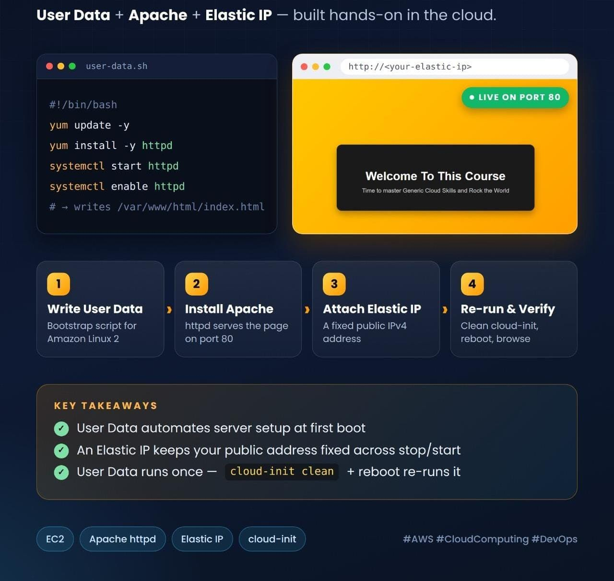

# ☁️ AWS EC2 Automated Web Server & Elastic IP Infrastructure

<div align="center">



</div>

<p align="center">
  
  
  
  
</p>

---

## 📖 Executive Summary
This repository showcases an automated cloud infrastructure deployment on **Amazon Web Services (AWS)**. The project focuses on zero-touch server provisioning using **EC2 User Data scripts**, Apache HTTP server deployment, custom HTML5/CSS landing page rendering, and static public networking via **Elastic IPs**.

📄 **[View Lab Documentation (PDF)](cloud-automation-ec2-webapp.pdf)**

---

## 🏗️ Architecture & Component Stack
The EC2 instance acts as a self-configuring web server that initializes and deploys a fully styled static webpage upon first boot:

| Component | Port | Service Role & Function |
| :--- | :---: | :--- |
| **Amazon EC2 (`t3.micro`)** | — | Core compute resource running Amazon Linux. |
| **Apache HTTPD** | `80` | Web server configured to serve content automatically on startup. |
| **Elastic IP (EIP)** | — | Dedicated static public IP address allocated to ensure persistent accessibility. |

---

## ⚙️ Implementation Workflow

### 1. Provisioning & Configuration Automation
- Launched an Amazon EC2 instance running Amazon Linux.
- Injected an automated **User Data boot script** to update packages, install the Apache web server (`httpd`), and enable persistent service daemons.

### 2. Frontend & Static Webpage Deployment
- Deployed a custom HTML5 landing page directly to `/var/www/html/index.html`.
- Implemented a responsive design featuring a gold-to-orange gradient background and a dark glassmorphic card layout.

### 3. Networking & Elastic IP Association
- Allocated a static Elastic IP address from the AWS Console.
- Associated the Elastic IP with the EC2 instance ID (`i-0bdbd781eaddd58b2`) to maintain a permanent, unchanging public IP address across reboots.

---

## 📜 User Data Automation Script
```bash
#!/bin/bash
yum update -y
yum install -y httpd
systemctl start httpd
systemctl enable httpd
cat << 'EOF' > /var/www/html/index.html
<!DOCTYPE html>
<html>
<head>
    <style>
        body {
            margin: 0;
            height: 100vh;
            display: flex;
            justify-content: center;
            align-items: center;
            background: linear-gradient(135deg, #ffd700, #ff8c00);
            font-family: Arial, sans-serif;
        }
        .card {
            background-color: #1a1a1a;
            padding: 40px 60px;
            border-radius: 12px;
            text-align: center;
            box-shadow: 0 8px 16px rgba(0,0,0,0.3);
        }
        h1 {
            color: #ffffff;
            margin-bottom: 10px;
            font-size: 28px;
        }
        p {
            color: #cccccc;
            font-size: 14px;
            margin: 0;
        }
    </style>
</head>
<body>
    <div class="card">
        <h1>Welcome To This Course</h1>
        <p>Time to master Generic Cloud Skills and Rock the World</p>
    </div>
</body>
</html>
EOF
